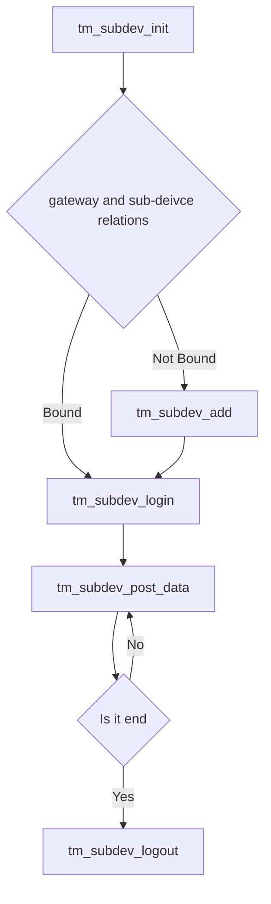

# MQTT protocol OneJson SDK

## 1.Usage

### (1) Create product and device
First,go to OneNET and register new account and login.
Then create pruduct in product management page ,choose MQTT for access protocol,and OneJson for data format.

At last,create device in device management, assigned to the created product. Copy the device name, device key, product ID in device detail page.

### (2) Modify device params
Modify device name, device key, product ID in examples/things_model/main.c
### (3) How to compile

Note:
If the device created on the platform uses the MQTT 5.0 protocol, CONFIG_MQTT_VERSION_5 in CMakeLists.txt must be ON.
If it uses the MQTT protocol, CONFIG_MQTT_VERSION_5 must be OFF.
Otherwise, a protocol mismatch will prevent connection.

use cmake to compile,like this:
``` shell
    mkdir build
    cd build
    cmake ..
    cmake --build . -j8 --config Release # config option only effect under windows
```
you can compile it in windows,but need to install Visual Studio with CMake tool

### (4) Install compile tool
Need to install cmake, gcc compiler and make

### (5) Debug with VSCode

Add gdb in VSCode debug setting
``` json
    {
        "name": "mqtts_onejson_soc",
        "type": "cppdbg",
        "request": "launch",
        "program": "${workspaceFolder}/build/mqtts_onejson_soc",
        "args": [],
        "stopAtEntry": false,
        "cwd": "${workspaceFolder}",
        "environment": [],
        "externalConsole": false,
        "MIMode": "gdb"
    }
```

## 2.Thing model related files
Thing model related files including examples/things_model/tm_user.c，examples/things_model/tm_user.h,can be replaced with actual used one

## 3.Supported platform
This SDK is for linux platform, can add support for other platform by adding port files in platforms dir

## 4.sub-deivce from gateway

Refer to onenet/tm/tm_subdev.h

Enable the defination in cmake file
```C
    -DCONFIG_TM_GATEWAY=1
```


